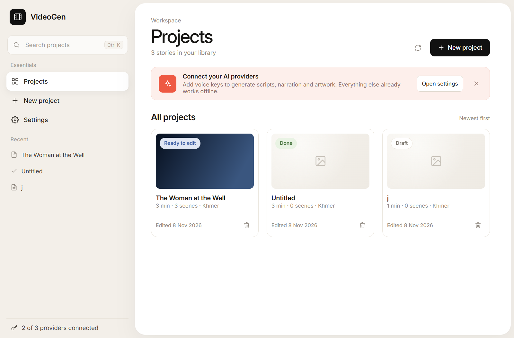
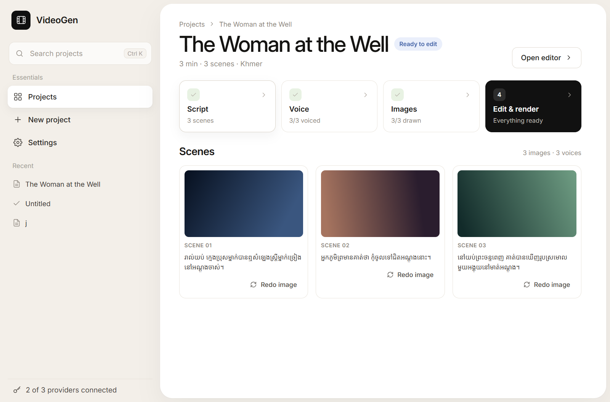

# VideoGen

Desktop tool for 1–60 minute 2D-animated Khmer ghost-story videos for YouTube.
Built with Tauri 2 + React 19 + Rust from
[`../videogen-khmer-ghost-build.md`](../videogen-khmer-ghost-build.md).

**Flow:** Settings → Create project → Prompt → Duration → Style → Script → Voice →
Images → Editor (subtitles) → Render → Export.





## Run

```powershell
cd D:\craft-tool\videogen
npm install
npm run tauri dev
```

Release build (installers land in `src-tauri/target/release/bundle`):

```powershell
npm run tauri build
```

## Settings (first launch)

Open **Settings** and save these before generating anything. Keys are stored in the
Windows Credential Manager (service `videogen`), never in project files.

| Section | What you need |
|---|---|
| Script model | Gemini / OpenAI / Anthropic / OpenAI-compatible key + model name |
| Voice | **Azure Speech** key + region, **VoxCPM 2** local server, or **GPT-SoVITS** local server + reference voice |
| Images (Cloudflare Workers AI) | Account ID + API token (FLUX schnell by default) |

Each key field has a **Test** button: it calls the live provider with the values
currently typed (you do not have to save first) and shows the result inline.

### Where to get the keys

| Provider | Get a key |
|---|---|
| Google Gemini | <https://aistudio.google.com/app/apikey> — sign in, **Create API key** (free tier) |
| OpenAI | <https://platform.openai.com/api-keys> — **Create new secret key** (billing credit required) |
| Anthropic Claude | <https://console.anthropic.com/settings/keys> — **Create key** |
| OpenRouter (OpenAI-compatible) | <https://openrouter.ai/keys> — base URL `https://openrouter.ai/api/v1` |
| DeepSeek (OpenAI-compatible) | <https://platform.deepseek.com/api_keys> — base URL `https://api.deepseek.com/v1` |
| Groq (OpenAI-compatible) | <https://console.groq.com/keys> — base URL `https://api.groq.com/openai/v1` |
| Azure Speech | <https://portal.azure.com> — create a **Speech** resource, then copy a key from *Keys and Endpoint* |
| Cloudflare Workers AI | <https://dash.cloudflare.com/profile/api-tokens> — create a token with **Workers AI** permission; Account ID is on the *Workers & Pages* overview |

## VoxCPM 2 voice (local)

VoxCPM 2 runs on your own PC, needs no cloud key, speaks **30 languages including
Khmer**, and can either invent a voice from a description or clone one from a clip.

Settings → **Voice** → engine **Auto (recommended)** or **VoxCPM 2**. With **Auto**,
the app probes the NVIDIA GPU once at startup and routes each project to VoxCPM 2
when the card has at least **5.5 GB VRAM**; otherwise it falls back to Edge TTS.
The Settings screen shows the detected GPU and the resolved route. If the local
server is unreachable, the pipeline can fall back to Edge TTS
(`voxcpm_auto_fallback`).

The app calls the OpenAI-compatible `POST /v1/audio/speech` endpoint, so it works
with two backends:

| Backend | Platform | Start command |
|---|---|---|
| `tools/voxcpm_server.py` (bundled) | Windows, NVIDIA GPU | `python tools\voxcpm_server.py` |
| vLLM-Omni | Linux + GPU | `vllm serve openbmb/VoxCPM2 --omni --port 8000` |

### Windows setup (bundled server)

VoxCPM needs Python 3.11 or 3.12, an NVIDIA GPU (≥5.5 GB VRAM for Auto routing),
and CUDA 12.

> **Hardware:** VoxCPM 2 is a 2B-parameter model. Below 5.5 GB VRAM, **Auto** stays
> on Edge TTS, but you can still install VoxCPM explicitly from Settings: the app
> installs CPU PyTorch and starts the server with `--device cpu` in low-memory
> mode. Generation is several times slower (a sentence can take minutes), so Edge
> TTS remains the faster choice on small GPUs. CPU inference needs roughly 16 GB
> of system RAM to be comfortable; with 8–12 GB the server automatically switches
> to a low-memory loader (`--low-memory`) that streams the weights instead of
> copying them. If neither fits, keep Edge TTS/Azure/GPT-SoVITS or point
> **Server URL** at a cloud GPU running vLLM-Omni.

```powershell
cd D:\craft-tool\videogen

# 1. Virtual environment (3.11 or 3.12)
py -3.12 -m venv .venv-voxcpm
.\.venv-voxcpm\Scripts\Activate.ps1

# 2. GPU PyTorch first, then VoxCPM
pip install torch torchaudio --index-url https://download.pytorch.org/whl/cu124
pip install voxcpm

# 3. Start the local OpenAI-compatible server
.\tools\start_voxcpm.ps1 -Cpu
# or, with a GPU that has >= 8 GB VRAM:
.\tools\start_voxcpm.ps1
# or directly:
python tools\voxcpm_server.py --device cpu
```

The launcher uses `.venv-voxcpm` and `tools\models\VoxCPM2` when they exist. On the
first run the server downloads ~5 GB from Hugging Face; if that stalls, download the
repo files manually with `curl` into `tools\models\VoxCPM2` (`model.safetensors`,
`audiovae.pth` and the small config/tokenizer files) and the launcher picks them up.

Keep that window open. It listens on `http://127.0.0.1:8000`; check
<http://127.0.0.1:8000/health> in a browser. Optional flags:
`--port 8000`, `--device cuda`, `--cfg 2.0`, `--steps 10`, `--denoise`,
`--model openbmb/VoxCPM2`, `--no-optimize` (if `torch.compile` crashes),
`--low-memory` (default below 12 GB RAM), `--no-low-memory`.

### Settings

- **Server URL** — `http://127.0.0.1:8000`
- **Model** — `openbmb/VoxCPM2` (or a local folder)
- **Voice design** — a plain-English description such as *“A slow, warm female
  storyteller with a mysterious tone”*. Leave it empty and leave reference audio
  empty for the default voice.
- **Reference audio** (optional) — 3–10 s clip to clone. The app reads the file and
  sends it inline, so the server does not need access to your disk.
- **Reference transcript** (optional) — exact words of the clip, enabling VoxCPM’s
  “ultimate cloning” (keeps rhythm and emotion).
- **Test VoxCPM** — sends an English sample through the real endpoint.

### Notes

- Voice design and cloning are mutually exclusive in practice: set a description
  *or* a reference clip. Both together still work, with the clip winning on timbre.
- A fixed seed (42) is sent on every request so a designed voice stays the same
  character across scenes and regeneration is reproducible. If scenes still drift,
  generate one good line, save it as a WAV, and use it as the reference clip.
- `cfg`/`timesteps` defaults are 2.0 and 10. With vLLM-Omni these are fixed by its
  deploy config, not per request.
- Horror style's slower pacing applies to Azure and GPT-SoVITS only; for VoxCPM add
  “speaks slowly” to the voice description.
- Audio comes back as 48 kHz WAV; the pipeline saves the matching extension and
  renders it like any other engine.
- Khmer: write the narration in Khmer (`Target text`) and describe the voice in
  English. No fine-tuning is required.
- Switching engines only affects newly generated audio. Use **Clear** on a scene's
  audio (or regenerate) to re-voice existing projects.

### Sharing a build (one-click engine install)

`tools/package_dist.ps1` creates a shareable folder. The recipient does **not**
need a terminal or a manually started server:

1. Build/share the package (`powershell -File tools\package_dist.ps1`; add
   `-IncludeModel` to bundle the ~5 GB weights instead of downloading them).
2. The recipient runs `videogen.exe`, opens **Settings → Voice**, and clicks
   **Install Local Voice Engine**. The app installs Python if needed, creates a
   private virtual environment in `%APPDATA%`, installs PyTorch + VoxCPM 2, and
   starts the local server automatically.
3. The server is started on every launch afterwards and stopped when the app
   exits. If it cannot start and **Fall back to Edge TTS** is enabled, voice
   generation continues with Edge TTS instead of failing.

The server script is embedded in the executable, so a lone `videogen.exe` still
works; the packaged `tools/` folder additionally provides the default reference
voice.

## GPT-SoVITS voice (local)

Voice cloning on your own machine, no cloud key. Settings → **Voice** → engine
**GPT-SoVITS**.

1. Install [GPT-SoVITS](https://github.com/RVC-Boss/GPT-SoVITS) and prepare a voice
   (pretrained model, or fine-tune on your own clips in its WebUI).
2. Start its API server and keep the window open:
   ```powershell
   python api_v2.py -a 127.0.0.1 -p 9880
   ```
3. In Settings → Voice, set:
   - **Server URL** — `http://127.0.0.1:9880`
   - **Reference audio** — a clean 3–10 second clip (Browse…), path on the same machine
   - **Prompt text** — the *exact transcript* of that clip
   - **Prompt language** and **Narration language**
4. Press **Test GPT-SoVITS**; it should return audio bytes, then generate the voice
   for a project.

Notes:

- GPT-SoVITS speaks English, Chinese, Japanese, Korean and Cantonese. Khmer needs a
  custom fine-tuned model, so use English (or a community Khmer voice build).
- Horror style narrates 10% slower (`speed_factor` × 0.9).
- Audio is saved as `.wav` from GPT-SoVITS and `.mp3` from Azure; both are probed
  with ffprobe and rendered the same way.
- Switching engines only affects newly generated audio. Use **Clear** on a scene's
  audio (or regenerate) to re-voice existing projects.

## Assets already in place

- `src-tauri/fonts/NotoSansKhmer-Regular.ttf` — Noto Sans Khmer, embedded for
  burned-in subtitles.
- `public/fonts/NotoSansKhmer-Regular.ttf` — the same font for editor preview
  (`@font-face`).
- `src-tauri/binaries/ffmpeg-x86_64-pc-windows-gnu.exe` and
  `ffprobe-x86_64-pc-windows-gnu.exe` — static builds with libass + HarfBuzz +
  libx264, used as Tauri sidecars (and bundled by `tauri build`).

The sidecar name must match the Rust target triple (`rustc -Vv`, `host:`). For a
different machine/toolchain, rename or replace the two binaries accordingly.

In development, if the sidecar is missing the app falls back to `ffmpeg` /
`ffprobe` on `PATH`.

## Data

Projects live in `%APPDATA%\com.videogen.app\projects\<id>\`:

```
audio/scene_001.mp3
images/scene_001.jpg|png
clips/scene_001.mp4
fonts/NotoSansKhmer-Regular.ttf
subs.ass  subs.srt  clips.txt
final.mp4
```

Stage is stored per project: `Draft → ScriptReady → VoiceReady → ImagesReady →
Editing → Rendered`. Re-running a stage only fills in what is missing, so retries
are cheap.

## Khmer shaping check

If grown vowels or subscript consonants look broken in the rendered video, the
FFmpeg build lacks HarfBuzz. Quick check:

```powershell
ffmpeg -f lavfi -i color=c=black:s=1920x1080:d=3 -vf "ass=test.ass:fontsdir=fonts" test.mp4
```

## Notes

- Script generation is chunked into chapters of 20 scenes, so long videos stay
  inside a single LLM call's limits.
- Final length is the sum of the real voice-over lengths; it can differ from the
  target duration.
- Concurrency is 4 for voice and 3 for images. Lower it in `pipeline.rs` if you
  hit 429s.
- FLUX schnell returns a square image; FFmpeg center-crops to 16:9, so keep the
  subject near the center.
